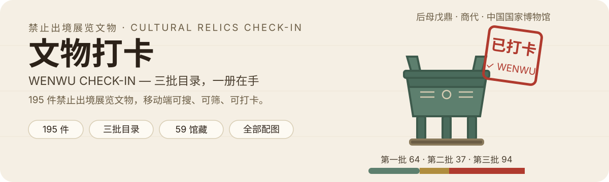
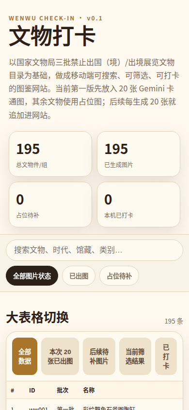
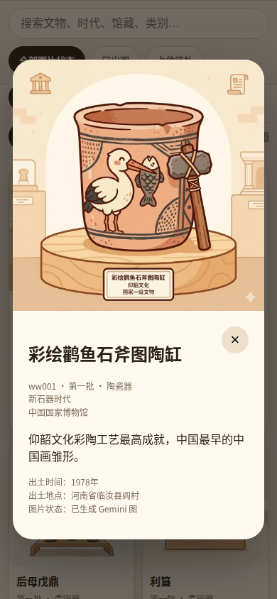

<p align="right"><a href="README.md">中文</a></p>

<p align="center">
  
</p>

<p align="center">
  <a href="https://xiaosang.cc/wenwu-checkin/">▶ Check In Online</a>
  ·
  <a href="https://github.com/holynova/wenwu-checkin">GitHub Repository</a>
</p>

A mobile check-in catalog of 195 Chinese cultural relics prohibited from overseas exhibition, based on the three official batches published by the National Cultural Heritage Administration. Search, filter by batch/category/image status, check in relic by relic (saved in your browser's localStorage), and open any item for its period, museum, excavation details, and notes. All 195 items are illustrated.

## Screenshots

<p align="center">
  
  
</p>

## Catalog

| Batch | Count | Highlights |
| --- | --- | --- |
| 第一批 (Batch 1) | 64 | 彩绘鹳鱼石斧图陶缸 (Painted Stork-Fish-Stone Axe Pottery Jar), 后母戊鼎 (Houmuwu Ding), 利簋 (Li Gui), 大盂鼎 (Da Yu Ding) |
| 第二批 (Batch 2) | 37 | 西晋陆机平复帖卷 (Lu Ji's Pingfu Tie, Western Jin), 唐冯承素摹兰亭序卷 (Feng Chengsu's Copy of the Lanting Xu, Tang), 唐韩滉五牛图卷 (Han Huang's Five Oxen, Tang), 北宋王希孟千里江山图卷 (Wang Ximeng's A Thousand Li of Rivers and Mountains, Northern Song) |
| 第三批 (Batch 3) | 94 | 红山文化玉勾云形器 (Hongshan Culture Jade Hook Cloud-Shaped Ornament), 良渚文化玉神人兽面纹琮 (Liangzhu Culture Jade Cong with Deity and Beast Mask), 战国曾侯乙编钟 (Zeng Houyi Bells, Warring States), 战国曾侯乙尊盘 (Zeng Houyi Zun and Pan, Warring States) |

Counted from `assets/data/catalog.json`: 8 categories (青铜器 Bronzes 56, 书画典籍 Paintings & Books 38, 玉器 Jades 35, 陶瓷器 Ceramics 27, 其他 Others 15, 石刻造像 Stone Carvings 10, 金银器 Gold & Silver 8, 漆木简牍 Lacquer & Bamboo Slips 6), 59 museums, 32 periods. Each record has a name, batch, category, period, museum, excavation time and place, notes, and an illustration.

## Features

- **Search**: full-text matching across name, period, museum, category, batch, and notes.
- **Filters**: batch (1st / 2nd / 3rd), category (8 categories), image status (全部 All / 已出图 Illustrated / 占位待补 Placeholder Pending).
- **Data table**: 5 switchable views — 全部数据 (All Data), 已出图 (Illustrated), 待补图片 (Pending Images), 当前筛选结果 (Current Filter), 已打卡 (Checked In).
- **Catalog cards**: lazy-loaded images; each card shows batch, category, period, and museum. Tap 「打卡」 ("Check in") to toggle the check-in state, 「详情」 ("Details") to open the modal.
- **Detail modal**: large image, ID, batch, category, period, museum, notes, excavation time and place, and image status.
- **Persistent check-ins**: check-in state is saved in `localStorage` (key `wenwuChecked`), on your device only — nothing is uploaded.

## Tech

- Vanilla HTML + CSS + JS, zero build, zero dependencies — just open `index.html`.
- Data: `assets/data/catalog.json` (195 entries, with `generated_at` / `total` / `image_count` summary fields).
- Images: 195 cartoon illustrations (WebP, `assets/images/ww001.webp`–`ww195.webp`), generated in batches; `placeholder.webp` is the placeholder image.

```
index.html                 Page structure (header stats, search & filters, table, card grid, detail modal)
app.js                     Search, filters, table views, check-ins, detail modal
styles.css                 Mobile-first styles
assets/data/catalog.json   Catalog data for 195 relics
assets/images/ww*.webp     195 cartoon illustrations of the relics
```
