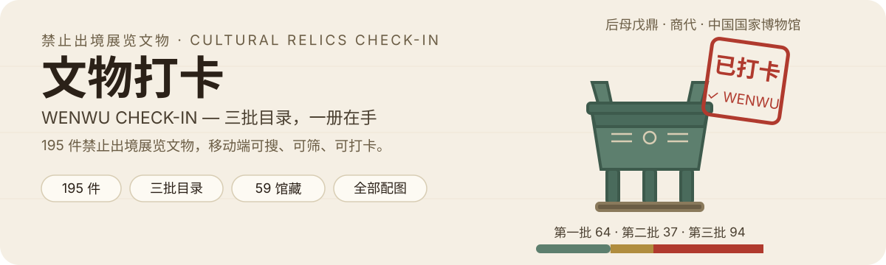
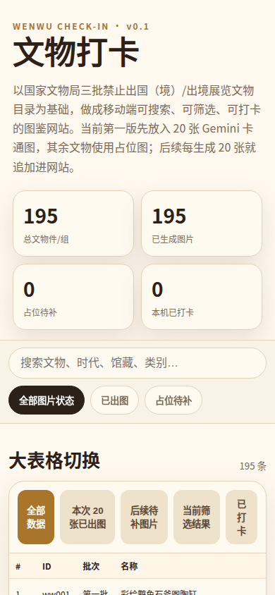
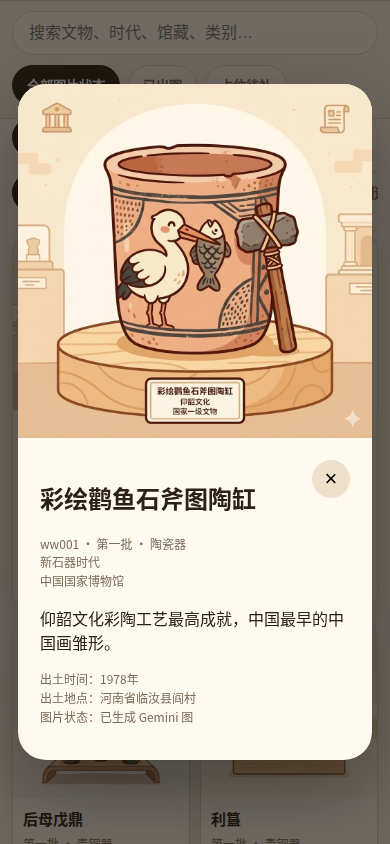

<p align="center">
  
</p>

<p align="center">
  <a href="https://xiaosang.cc/wenwu-checkin/">▶ 在线打卡 View Online</a>
  ·
  <a href="https://github.com/holynova/wenwu-checkin">GitHub 仓库</a>
</p>

195 件/组禁止出境展览文物的移动端打卡图鉴，以国家文物局三批禁止出境展览文物目录为基础：可搜索、可按批次/类别/图片状态筛选、可逐件打卡（打卡状态存在本机浏览器，刷新不丢），点详情看每件文物的时代、馆藏、出土信息与说明。195 件全部配图。

A mobile check-in catalog of 195 Chinese cultural relics prohibited from overseas exhibition, based on the three official batches published by the National Cultural Heritage Administration. Search, filter by batch/category/image status, check in relic by relic (saved in your browser's localStorage), and open any item for its period, museum, excavation details, and notes. All 195 items are illustrated.

## 截图 / Screenshots

<p align="center">
  
  
</p>

## 目录 / Catalog

| 批次 | 件数 | 亮点 |
| --- | --- | --- |
| 第一批 | 64 | 彩绘鹳鱼石斧图陶缸、后母戊鼎、利簋、大盂鼎 |
| 第二批 | 37 | 西晋陆机平复帖卷、唐冯承素摹兰亭序卷、唐韩滉五牛图卷、北宋王希孟千里江山图卷 |
| 第三批 | 94 | 红山文化玉勾云形器、良渚文化玉神人兽面纹琮、战国曾侯乙编钟、战国曾侯乙尊盘 |

按 `assets/data/catalog.json` 实数：8 个类别（青铜器 56、书画典籍 38、玉器 35、陶瓷器 27、其他 15、石刻造像 10、金银器 8、漆木简牍 6），涉及 59 家馆藏单位、32 个时代。每件记录：名称、批次、类别、时代、馆藏、出土时间、出土地点、说明与配图。

## 功能 / Features

- **搜索**：按名称、时代、馆藏、类别、批次、说明全文匹配。
- **筛选**：批次（第一/二/三批）、类别（8 类）、图片状态（全部/已出图/占位待补）。
- **大表格**：5 种视图切换——全部数据、已出图、待补图片、当前筛选结果、已打卡。
- **图鉴卡片**：懒加载图片，卡片显示批次、类别、时代、馆藏；点「打卡」切换状态，点「详情」打开弹窗。
- **详情弹窗**：大图、编号、批次、类别、时代、馆藏、说明、出土时间与地点、图片状态。
- **打卡持久化**：打卡状态存 `localStorage`（键 `wenwuChecked`），只在本机，不上传。

## 技术 / Tech

- 原生 HTML + CSS + JS，无构建、无依赖，打开 `index.html` 即用。
- 数据：`assets/data/catalog.json`（195 条，含 `generated_at` / `total` / `image_count` 汇总字段）。
- 图片：195 张卡通插画（WebP，`assets/images/ww001.webp`–`ww195.webp`），分批生成；`placeholder.webp` 为占位图。

```
index.html                 页面结构（头部统计、搜索筛选、表格、卡片网格、详情弹窗）
app.js                     搜索、筛选、表格视图、打卡、详情弹窗
styles.css                 移动端优先样式
assets/data/catalog.json   195 件文物目录数据
assets/images/ww*.webp     195 张文物卡通插画
```

## English

**Wenwu Check-in** — a mobile catalog of 195 cultural relics prohibited from overseas exhibition (National Cultural Heritage Administration, three batches: 64 + 37 + 94).

- **Catalog**: 8 categories (bronzes 56, paintings & books 38, jades 35, ceramics 27, others 15, stone carvings 10, gold & silver 8, lacquer & bamboo slips 6), 59 museums, 32 periods. Every item has a period, museum, excavation time/place, notes, and an illustration.
- **Features**: full-text search (name, period, museum, category, batch, notes); batch/category/image-status filters; a data table with 5 views (all, illustrated, pending, current filter, checked-in); a lazy-loaded card grid; a detail modal; check-ins persisted in `localStorage` only — nothing is uploaded.
- **Tech**: vanilla HTML/CSS/JS, zero dependencies, zero build; data in `assets/data/catalog.json`; 195 cartoon illustrations (WebP) in `assets/images/`.
